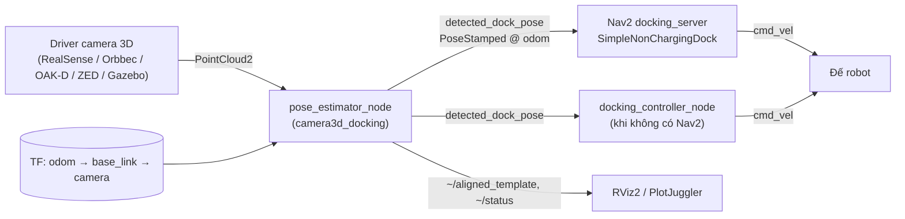

# Thiết kế: Docking robot bằng Camera 3D (point cloud) trên phần cứng yếu

- **Ngày:** 2026-11-16
- **Trạng thái:** Đã chốt hướng (người dùng giao toàn quyền "bắt tay vào làm")
- **Kế hoạch triển khai:** [`docs/superpowers/plans/2026-11-16-camera3d-docking.md`](../plans/2026-11-16-camera3d-docking.md)

---

## 1. Mục tiêu và lý do

Robot (AMR / xe nâng tự hành) cần **tiến vào sát một vật cố định** như pallet, rack hay trạm sạc, với sai số nhỏ. Trước đó robot đã được điều hướng thô tới trước vật (sai số định vị toàn cục cỡ 0.1–0.5 m). Camera 3D phải đo **pose tương đối** của vật, sau đó bộ điều khiển đưa robot vào đúng vị trí.

Bối cảnh từ người dùng:

- **Vật cần dock:** "bất kỳ vật gì", có thể là pallet, rack…
- **Camera:** chưa biết loại, chỉ biết nó **trả ra đám mây điểm**.
- **Máy tính trên robot:** chưa biết, **có thể yếu**.
- **Yêu cầu:** "làm tối ưu và chính xác nhất".

| Mã | Mục tiêu |
|----|----------|
| G1 | Ước lượng pose của vật (x, y, z, yaw) từ `sensor_msgs/PointCloud2` của **bất kỳ** camera 3D nào, dựa trên một **template** của vật. |
| G2 | Xuất `detected_dock_pose` (`geometry_msgs/PoseStamped`) để dùng thẳng với **Nav2 Docking** (`opennav_docking`). |
| G3 | Có **bộ điều khiển docking độc lập** (xuất `cmd_vel`) cho robot không chạy Nav2. |
| G4 | **Nhẹ:** mỗi khung ≤ 50 ms ở chế độ bám trên CPU cỡ Raspberry Pi 5, chỉ dùng numpy + scipy (gói apt). Không GPU, không PyTorch/Open3D/PCL. |
| G5 | **Chính xác:** trong mô phỏng, sai số cuối ≤ 2 cm ngang và ≤ 2° hướng. Trên robot thật, mục tiêu ≤ 2 cm / ≤ 1.5° khi đo ở khoảng 1 m. Để so sánh, xe nâng trong bài ICARCV'18 cần ≤ 5 cm / ≤ 2°. |
| G6 | **An toàn thông tin:** thà **không xuất** pose còn hơn xuất pose sai. Phải từ chối khi kết quả suy biến, mơ hồ hoặc kém chất lượng. |
| G7 | Có **mô phỏng Gazebo** để kiểm thử end-to-end trước khi chạy trên robot thật. |

**Không làm (non-goals):**

- Huấn luyện mô hình YOLO. Chỉ chừa sẵn điểm móc nối ở giai đoạn sau.
- SLAM / định vị toàn cục. Phần này do Nav2/AMCL đảm nhận.
- Tránh vật cản an toàn. Phần này do lớp an toàn của robot đảm nhận (laser safety, collision monitor).
- Vật thể đang di chuyển.

**Phản mục tiêu (anti-goals):** coi là thất bại dù code vẫn chạy.

- Cần GPU trên robot.
- Kéo theo thư viện nặng lên robot.
- Xuất pose sai mà không cảnh báo.
- Phụ thuộc vào một hãng camera cụ thể.

## 2. Ràng buộc

- Ubuntu 24.04, **ROS 2 Jazzy**, Python 3.12, numpy 1.26 + scipy 1.11 lấy từ apt.
- Máy dev có sẵn numpy 2.5.3 và opencv 5 cài bằng pip trong `~/.local`. numpy 2.5.3 làm hỏng `scipy.spatial` của apt. Vì vậy mọi node và test **chạy với `PYTHONNOUSERSITE=1`**: node tự khởi động lại chính nó với biến này, launch file cũng đặt sẵn.
- Đầu vào duy nhất bắt buộc là `PointCloud2` + TF `base_link ← frame camera`. Đám mây có thể organized hoặc unorganized, có thể có NaN.
- Robot di chuyển trên **sàn phẳng**. Vật đứng thẳng trên sàn, nên roll/pitch của vật ≈ 0.

## 3. Bài học từ tài liệu và repo

### 3.1 Hai bài báo

**Behrje et al., ICARCV 2018:** xe nâng tự hành dùng camera ToF.

- **Chia hai pha:**
  - Pha 1: định vị toàn cục bằng AMCL. Sai số ~0.5 m vẫn chấp nhận được.
  - Pha 2: đo pose *tương đối* của pallet bằng camera, rồi đi đường cong Bézier có đoạn cuối **thẳng**. Ở pha 2, pose lấy từ **odometry + pose cục bộ của pallet**, không lấy từ định vị toàn cục.
  - → Thiết kế của ta dùng đúng mô hình này: lọc pose vật trong frame `odom`.
- **Ép depth thành "laser scan" 2D:** lấy điểm gần nhất theo từng cột ảnh trong một dải độ cao. Mục đích là chạy nhẹ.
  - → Tìm kiếm toàn cục của ta chiếu xuống mặt phẳng 2D, nhưng chia thành **nhiều dải độ cao** (2.5D) để không mất các hốc pallet.
- **Yêu cầu chính xác:** ≤ 5 cm ngang (biên độ sideshift của càng), ≤ 2° hướng.
- **Lỗi thực tế:** hệ thống từng nhận pallet lệch đúng **nửa chiều rộng pallet** (40 cm) do template khớp vào chỗ đối xứng.
  - → Bắt buộc có **kiểm tra mơ hồ**: so giả thuyết tốt nhất với giả thuyết tốt nhì.
- **Giới hạn của camera ToF:** FOV hẹp (85°) và tầm ngắn.
- **Giảm tốc khi có vật cản:** giảm tốc trong phạm vi 2 m, dừng ở 0.3 m.

**Aghili, arXiv 2211.03026:** rendezvous & docking trong không gian bằng thị giác 3D.

- Phép đo thị giác 3D **nhiễu, tần số thấp (1–2 Hz) và có thể bị che khuất**.
- Bộ lọc Kalman dùng mô hình chuyển động giúp **dự đoán pose khi mất quan sát** (hơn 20 s).
- Pose đo bằng **khớp mô hình CAD bề mặt (ICP)** với đám mây điểm.
- → Ta dùng Kalman với mô hình *vật đứng yên trong `odom`*. Nhờ đó robot vẫn có pose đích trong **vùng mù**: khi quá gần, camera không còn thấy vật vì nằm dưới tầm tối thiểu hoặc vật ra ngoài FOV. Hiệp phương sai đo lấy từ ICP rồi phóng đại lên.

### 3.2 Các repo đã clone (`references/`)

| Repo | Học được gì | Dùng thế nào |
|------|-------------|--------------|
| `snenyl/realtime-pose-estimation` | YOLOX (OpenVINO) → cắt **frustum** từ 4 góc bbox → RANSAC mặt phẳng (2 lần) → giao tia tâm bbox với mặt phẳng. Dùng **ArUco làm ground truth** để đo sai số. | Ý tưởng frustum (móc YOLO ở giai đoạn sau). Ý tưởng **đo sai số bằng marker**. Không dùng code: C++ thuần, nhiều hằng số "magic", không phải ROS. |
| `mgonzs13/yolo_ros` | Plugin 3D: thống kê depth **bền vững** (trimmed mean, phân vị, MAD), PCA để lấy hướng, lọc điểm lệch ±0.30 m quanh median. | Áp dụng thống kê bền vững (MAD) cho trọng số ICP. Có thể ghép làm nguồn bbox (`Detection2DArray`) sau này. |
| `AbdullahGM1/l2i_fusion_detection` | Đồng bộ `message_filters` ApproximateTime, chiếu 3D → 2D, `CropBox`, xuất `/detected_object_pose`. | Mẫu tham khảo; pose chỉ là trọng tâm (không có hướng) → ta phải làm tốt hơn. |
| `HanjiangHu/ROS-pose-estimation-module` | FPFH + SAC-IA (khớp thô) + ICP-NonLinear (khớp tinh), giảm dần `max_correspondence_distance`. | Ý tưởng **thô → tinh**. FPFH quá nặng cho máy yếu (và repo là ROS1) → thay bằng tìm kiếm tương quan 2.5D. |
| `davidakhihiero/pallet_detection_and_segmentation` | YOLOv11 + SegFormer để tách sàn. | Bài học: tách sàn **không cần** mạng nơ-ron — RANSAC mặt phẳng sàn rẻ hơn hàng nghìn lần. |
| `open-navigation/opennav_docking` (đã nhập vào Nav2) | Kiến trúc docking chuẩn: staging pose → phát hiện → vòng lặp thị giác + **graceful controller** (Park & Kuipers 2011) → kiểm tra docked. Plugin nhận `detected_dock_pose`, biến đổi sang frame cố định theo TF tại *stamp* của phép đo, lọc EMA, dừng khi quá `external_detection_timeout`. | **Dùng trực tiếp** gói apt `ros-jazzy-opennav-docking` (plugin `SimpleNonChargingDock` cho pallet/rack). Bộ điều khiển độc lập của ta dùng **cùng luật điều khiển** và cùng giá trị mặc định (k_phi=3, k_delta=2, beta=0.4, lambda=2). |

### 3.3 Lỗi trong file hướng dẫn `.md` ban đầu (cần tránh)

1. **Lấy dx, dy, yaw từ sai phép biến đổi.** Code gọi `small_gicp.align(target=template, source=scan)`, nên kết quả là `T_target_source`, tức phép biến đổi **từ scan sang template** = `T_vật←robot`. Pose của vật trong hệ robot là **nghịch đảo** của nó. Code lấy thẳng `T[0,3]`, `T[1,3]` nên sai cả dấu lẫn giá trị khi có góc xoay.
2. **Khởi tạo sai chiều.** `init_T[:3,3] = centroid_source - centroid_target` ngược chiều với ý nghĩa của `T_target_source`.
3. **Gọi API không tồn tại.** API small_gicp không có tham số `init_T=` (đúng tên là `init_T_target_source`) và không có thuộc tính `result.inlier_fraction`.
4. **Lấy bbox đầu tiên mà không lọc theo class.**
5. **Dùng ROS 2 Humble.** Máy chạy Ubuntu 24.04 nên phải dùng **Jazzy**.
6. **Lọc sàn bằng ngưỡng cứng `Z > -0.20`.** Cách này giả định camera nằm ngang tuyệt đối; lệch pitch 1° đã làm sai ~3.5 cm ở 2 m. → Ta dùng **cân bằng sàn bằng RANSAC**.

## 4. Các hướng tiếp cận đã cân nhắc

| Hướng | Ưu | Nhược | Quyết định |
|-------|----|-------|-----------|
| **A. YOLO 2D → frustum → ICP** (theo file .md và các repo) | Tốt trong cảnh lộn xộn. | Cần **ảnh RGB** (camera có thể chỉ cho point cloud). Phải thu thập và gán nhãn dữ liệu cho từng loại vật. YOLO là khâu **nặng nhất** trên CPU yếu (~50–150 ms/khung trên RPi). Thêm phụ thuộc nặng. | Không làm mặc định. Chừa điểm móc nối `Detection2DArray` cho giai đoạn sau. |
| **B. Hình học thuần:** tìm kiếm tương quan 2.5D đa dải + ICP point-to-plane trên template | Không cần huấn luyện. Chạy với **mọi** camera có point cloud. Nhẹ (FFT + numpy). Tự đánh giá được độ tin cậy. | Cần template cho từng loại vật. Cảnh rất lộn xộn có thể gây nhầm. | **CHỌN.** Giảm rủi ro nhầm bằng ROI, phạt vùng-phải-trống và kiểm tra mơ hồ. |
| **C. Marker (AprilTag/ArUco)** | Rẻ, rất chính xác. | Phải dán marker lên **mọi** vật (không hợp với "vật bất kỳ"). Cần RGB. | Chỉ dùng làm **ground truth** khi đo sai số thực tế. |

## 5. Kiến trúc tổng thể



**Hai gói ROS 2** trong `ros2_ws/src/`:

- `camera3d_docking` (ament_python), gồm:
  - `core/`: thuật toán thuần numpy/scipy, **không import ROS**, test được độc lập.
  - `ros/`: chuyển đổi message.
  - `nodes/`: các node.
  - `tools/`: công cụ dòng lệnh tạo template và benchmark.
  - `config/`, `launch/`, `templates/`, `rviz/`, `test/`.
- `camera3d_docking_sim` (ament_python, chỉ chứa dữ liệu + launch): world Gazebo sinh từ **cùng** mô hình hộp với template, robot vi sai có camera RGB-D, bridge, kịch bản test end-to-end.

## 6. Hệ tọa độ và quy ước

- **`base_link`** theo REP-103: x tiến, y trái, z lên. **`odom`** là frame cố định cục bộ. Frame camera lấy từ `header.frame_id` của cloud.
- **Frame vật** (gắn với template):
  - Gốc ở **tâm mặt trước** của vật, **trên mặt sàn** (z = 0).
  - **+x hướng vào trong vật**, tức hướng robot đi khi tiến vào. +z hướng lên.
  - Khi robot đứng trước vật và nhìn thẳng vào, pose vật trong `base_link` có yaw ≈ 0 và x > 0.
- **Pose đích của robot:**

  ```
  T_odom_target = T_odom_vật · T(dock_offset_x, dock_offset_y, 0) · Rz(π nếu lùi vào)
  ```

  Trong đó:
  - `dock_offset_x < 0`: dừng trước mặt vật. Ví dụ −0.35 m nếu `base_link` cách mũi xe 0.35 m.
  - `dock_offset_x > 0`: càng nâng đi vào trong pallet.
- **Cân bằng sàn:** RANSAC tìm mặt sàn, rồi xoay/dịch đám mây sao cho pháp tuyến sàn = +z và sàn ở z = `floor_z`.
  - Phép này **chỉ sửa roll, pitch và độ cao** của ngoại tham số camera. Không đổi x, y, yaw.
  - Kết quả vẫn báo trong `base_link`, vì giả định đế robot song song với sàn.

## 7. Pipeline nhận diện (mỗi khung)

| # | Bước | Chi tiết | Tham số mặc định |
|---|------|----------|------------------|
| 1 | PointCloud2 → numpy | `np.frombuffer` (không vòng lặp Python). Nếu cloud là organized thì lấy mẫu thưa theo `stride` hàng/cột *trước* khi chuyển. Bỏ NaN/inf. | `cloud_stride` = 2 |
| 2 | Sang `base_link` | TF tại `header.stamp` của cloud, timeout 0.1 s. Nhân một ma trận 4×4. | |
| 3 | Cân bằng sàn | RANSAC trên các điểm gần sàn (dưới `floor_z + 0.15 m`). Chỉ nhận khi pháp tuyến lệch ≤ 10° so với +z và độ cao lệch ≤ 0.1 m. Làm mượt bằng EMA, cập nhật ≤ 1 lần/giây. Nếu không thấy sàn thì giữ kết quả cũ. | `floor_leveling` = true |
| 4 | Cắt ROI | Hộp trong `base_link`: x ∈ [0.25, 3.5] m, \|y\| ≤ 1.5 m, z ∈ [`floor_z` + 0.03, 2.0] m. Ngưỡng z dưới cũng là bước **xóa sàn**. | |
| 5 | Voxel | Lấy trọng tâm mỗi voxel bằng khóa nguyên + `np.unique` + `bincount`. Còn ~500–3000 điểm. Tùy chọn bỏ voxel có ít hơn k điểm để lọc "flying pixels". | `voxel_size` = 0.02 m |
| 6a | **Khởi tạo khi đang bám** | Lấy pose dự đoán từ Kalman (pose vật trong `odom`) đổi về `base_link` hiện tại. | |
| 6b | **Khởi tạo khi mất dấu** | Tìm kiếm tương quan toàn cục (§7.1) → top-5 giả thuyết (x, y, yaw). | |
| 7 | ICP tinh | §7.2. Chạy 3 tầng với `max_corr` = 0.15 / 0.06 / 0.03 m. | |
| 8 | Cổng chất lượng | §7.3: coverage, inlier, RMSE, σ, suy biến, mơ hồ. | |
| 9 | Kalman trong `odom` | §7.4. Có cổng Mahalanobis. | |
| 10 | Xuất kết quả | `detected_dock_pose` (frame `odom`). Kèm debug: template đã khớp, trạng thái JSON. | |

### 7.1 Tìm kiếm toàn cục: tương quan 2.5D đa dải độ cao (thay cho FPFH/YOLO)

**Ý tưởng.** Chia không gian theo độ cao thành `n_bands` = 3 dải bằng nhau trên chiều cao template. Trong mỗi dải, chiếu điểm xuống lưới 2D (x, y) với ô 3 cm.

- **Từ cảnh:**
  - `O_b`: lưới chiếm chỗ.
  - `L_b`: trường khả năng = `O_b` làm mờ Gauss σ = 1 ô, chuẩn hóa về [0, 1].
- **Từ template**, với mỗi góc yaw trong ±45°, bước 3°:
  - `P_b,θ`: các ô bề mặt template.
  - `F_b,θ`: các ô **phải trống**. Trong mỗi cột y (thuộc bề rộng vật) của dải b, đó là những ô *nằm trước* bề mặt đầu tiên theo +x, tính từ x = −0.05 m.
  - Ví dụ: hốc càng của pallet phải trống. Một bức tường phẳng sẽ có điểm ở đó và bị phạt. Nhờ vậy một bức tường không thể "giả làm" pallet.
- **Điểm số** tại mỗi (x, y, θ):

  ```
  score = Σ_b w_b·corr(L_b, P_b,θ)/ΣP_b,θ  −  0.5 · Σ_b corr(O_b, F_b,θ)/ΣF_b,θ
  ```

  với `w_b` ∝ số điểm template trong dải b.
  - Phép tương quan tính bằng **FFT** (`scipy.signal.fftconvolve`, mode `same`).
  - Template của mỗi góc xoay được tính trước một lần và lưu cache.
- **Lọc cực đại:** NMS với khoảng cách 0.15 m và 10°, giữ top-5 giả thuyết. Mỗi giả thuyết được chạy ICP.
- **Chi phí ước tính:** 3 dải × 31 góc × 2 phép tương quan trên lưới ~120×100 ô. Khoảng 50–100 ms trên PC, vài trăm ms trên RPi. Chỉ chạy khi **mất dấu**, không chạy mỗi khung.

### 7.2 ICP point-to-plane có thành phần tiếp tuyến

- **Ẩn và cách cập nhật.** Ta tìm `T_vật←base`, tức phép đưa điểm cảnh về hệ vật. Mỗi vòng cập nhật nhân trái một bước nhỏ ΔT có **4 bậc tự do {x, y, z, yaw}**. Roll/pitch bị khóa vì vật đứng trên sàn và cloud đã được cân bằng. Tùy chọn khóa thêm z, hoặc mở đủ 6 bậc.
- **Tìm tương ứng bằng lưới tra cứu.** Tính trước một **lưới 3D chứa chỉ số điểm template gần nhất** (ô 1 cm, tối đa ~4 triệu ô, tự tăng kích thước ô nếu vượt). Mỗi điểm cảnh tra cứu O(1), nhanh hơn KD-tree khoảng 5–10 lần. Đây là chỗ được lợi lớn nhất trên máy yếu. Điểm nằm ngoài lưới hoặc xa hơn `max_corr` bị bỏ.
- **Chi phí** cho sai lệch e = q − m (q là điểm cảnh trong hệ vật, m là điểm template, n là pháp tuyến):

  ```
  w · [ (n·e)² + ε‖e‖² ]   với ε = 0.05
  ```

  Riêng point-to-plane sẽ **trượt ngang** khi mặt vật hướng thẳng vào camera (mọi pháp tuyến ≈ −x). Số hạng tiếp tuyến ε kéo theo các mép và hốc nên khử được trượt này.
- **Trọng số Tukey** với tỷ lệ c = max(4.685·1.4826·MAD(r), 0.01 m). Giải bằng Levenberg–Marquardt (λ nhỏ). Dừng khi ‖δt‖ < 1e-4 m và ‖δθ‖ < 1e-4 rad, hoặc đạt 15 vòng mỗi tầng.
- **Hiệp phương sai:** `Cov = σ̂²·(JᵀWJ)⁻¹`, đổi sang (x, y, yaw) của **vật trong `base_link`**.

### 7.3 Cổng chất lượng: từ chối thay vì xuất sai

| Chỉ số | Định nghĩa | Ngưỡng mặc định |
|--------|-----------|-----------------|
| `coverage` | Tỷ lệ điểm template **quay mặt về camera** (n·hướng-tới-camera > 0) có điểm cảnh trong vòng 3 cm. | ≥ 0.35 |
| `inlier_ratio` | Tỷ lệ điểm cảnh (quanh vật) có \|n·e\| < 2 cm. | ≥ 0.5 |
| `rmse` | RMS của n·e trên các inlier. | ≤ 0.015 m |
| `sigma_xy`, `sigma_yaw` | Từ hiệp phương sai ICP đã phóng đại. | ≤ 0.02 m; ≤ 1.5° |
| Suy biến | λ_min/λ_max của khối Hessian (x, y, yaw·0.5 m). | ≥ 1e-3, nếu không đạt thì `DEGENERATE` |
| Mơ hồ | Ở chế độ tìm kiếm: giả thuyết tốt nhì *khác biệt* (> 5 cm hoặc > 3°) có điểm ≥ 0.9 × tốt nhất. | → `AMBIGUOUS` |
| Nhảy cóc khi bám | Kết quả lệch so với dự đoán > 0.25 m hoặc > 15°. | → chạy lại tìm kiếm |

### 7.4 Kalman (vật đứng yên trong `odom`) và vùng mù

- **Trạng thái và mô hình:**
  - Trạng thái (x, y, yaw) của vật trong `odom`. z lọc riêng bằng EMA.
  - Q: 5 mm/√s và 0.2°/√s, cho phép odometry trôi chậm.
  - R = max(25·Cov_ICP, R_min), với R_min = (5 mm)² và (0.3°)².
- **Cổng Mahalanobis:** χ²(3 bậc, 99.7%) = 14.16. Bị từ chối **5 lần liên tiếp** mà các phép đo mới nhất quán với nhau thì khởi tạo lại. Trường hợp này xử lý khóa sai lúc đầu.
- **Giữ pose (hold):** node tiếp tục phát pose Kalman 10 Hz với stamp = now khi:
  - (a) mới mất dấu dưới `hold_timeout` = 2 s, **hoặc**
  - (b) robot đang ở **vùng mù**, tức khoảng cách từ robot tới mặt vật < `blind_zone_distance` = 0.6 m.
- Vì vật đứng yên trong `odom`, pose này luôn đúng, chỉ trừ phần trôi odometry trên quãng ngắn. Nhờ vậy Nav2 không báo "Lost detection" ở đoạn cuối.

## 8. Template

- **Định dạng:** file `.npz` gồm `points (N,3)`, `normals (N,3)` và `meta` (JSON: tên, kích thước, nguồn, quy ước frame). Xuất được `.pcd` để xem trong CloudCompare.
- **Ba nguồn tạo template:**
  1. **Tham số hóa từ các hộp** (pallet khối, rack, dock chữ V):
     - Ray-cast từ nhiều điểm nhìn ảo phía trước vật: 2 độ cao camera × 5 góc ±40° × 2 khoảng cách.
     - Gộp các điểm **thực sự nhìn thấy** rồi voxel 1 cm.
     - Cũng chính các hộp này sinh ra world Gazebo, nên template và mô phỏng **khớp nhau tuyệt đối**.
  2. **CAD (STL/OBJ):** lấy mẫu bề mặt theo diện tích, bỏ các mặt quay lưng (n·(+x) ≥ 0). Hạn chế: không xét bị che, đủ dùng cho vật lồi.
  3. **Quét thực tế (chính xác nhất, vì mang cả đặc tính cảm biến):**
     - `cloud_saver_node` lưu cloud trong `base_link`. Robot đứng tại pose đã biết so với vật, đo bằng thước hoặc AprilTag.
     - `make_template from-cloud` biến đổi các điểm sang frame vật, cắt, gộp nhiều khung rồi voxel.
- **Pallet mặc định:** EUR/EPAL, vào từ mặt 800 mm. Kích thước 1200 × 800 × 144 mm. Khối 78 mm cao, rộng 100/145/100 mm, hốc rộng 227.5 mm. Ván mặt 22 mm. Mọi kích thước đều chỉnh được bằng tham số.

## 9. Điều khiển

**Đường A: robot có Nav2.**

- `docking_server` (gói `opennav_docking`) dùng plugin `opennav_docking::SimpleNonChargingDock` với `use_external_detection_pose: true`.
- `external_detection_translation_x` = −(khoảng dừng). Các góc xoay = 0.
- `filter_coef: 0.0`, vì bộ lọc Kalman của ta đã lọc rồi.
- Staging pose cách vật 0.7–1.2 m.

**Đường B: robot không có Nav2** → `docking_controller_node`.

- **Luật điều khiển mượt** Park & Kuipers (2011), cùng công thức với `nav2_graceful_controller`. Robot ở gốc, đích (x, y, ψ) trong `base_link`:

  ```
  α = atan2(y, x)
  φ = wrap(ψ − α)
  δ = wrap(−α)
  r = √(x² + y²)

  κ = −(1/r)·[k_δ·(δ − atan(−k_φ·φ)) + (1 + k_φ/(1 + (k_φ·φ)²))·sin δ]
  v = v_max / (1 + β·|κ|^λ),  giảm dần khi r < slowdown_radius
  ω = κ·v
  ```

  - Khi **lùi vào**: đổi hướng ảo +π và v < 0.
  - Có giới hạn gia tốc tuyến tính và góc.
- **Máy trạng thái:**

  ```
  IDLE → WAIT_DETECTION → APPROACH → BLIND → DOCKED
  ```

  - Khi lỗi: `FAILED` → `RETREAT` (lùi 0.5 m) → thử lại, tối đa 2 lần.
  - Dừng khi khoảng cách **dọc trục dock** tới đích < 1 cm.
  - Có thể dừng sớm bằng tín hiệu tiếp xúc `~/contact` (Bool).
  - Các timeout: chờ phát hiện 5 s, mất dấu 1 s (ngoài vùng mù), tổng 60 s.

## 10. Mô phỏng (Gazebo Harmonic qua `ros_gz`)

- **World:** sàn, tường, rack, pallet EUR (sinh từ cùng mô hình hộp với template), vài hộp gây nhiễu.
- **Robot:** vi sai dùng plugin `gz-sim-diff-drive-system`, công bố odom và TF `odom → base_link`.
  - Camera RGB-D 424×240 @ 15 Hz, HFOV 87° (giống D435).
  - Depth từ 0.2 đến 6 m, nhiễu Gauss σ 5 mm.
  - Đặt cao 0.30 m, chúc xuống 10°.
- **Bridge:** `/clock`, `/cmd_vel`, `/odom`, `/tf`, `/camera/points`, cùng pose ground truth của robot.
- **Test end-to-end:** spawn robot ở nhiều pose xuất phát → gọi `~/start` → chờ `DOCKED` → so pose thật với pose đích → báo **PASS/FAIL** theo ngưỡng của G5.

## 11. Giao diện ROS

**`pose_estimator_node`**

- **Subscribe:** `points` (`PointCloud2`, QoS sensor data, depth 1). Nếu xử lý chậm thì bỏ khung cũ, luôn xử lý khung mới nhất.
- **Publish:**
  - `detected_dock_pose` (`PoseStamped`, frame `odom`).
  - `~/pose_raw` (`PoseWithCovarianceStamped`, frame `base_link`).
  - `~/aligned_template` (`PointCloud2`, ≤ 2 Hz).
  - `~/roi_cloud` (`PointCloud2`, khi bật debug).
  - `~/status` (`std_msgs/String`, JSON).
- **Service:** `~/reset` (`Trigger`), `~/enable` (`SetBool`). Tắt node khi không docking để tiết kiệm CPU.
- **Tham số chính:**
  - Frame và template: `base_frame`, `fixed_frame`, `template_path`.
  - Tiền xử lý: `roi.*`, `floor_z`, `floor_leveling`, `cloud_stride`, `voxel_size`, `max_rate_hz` (10).
  - Thuật toán: `search.*`, `icp.*`, `quality.*`, `kalman.*`.
  - Vùng mù: `hold_timeout`, `blind_zone_distance`.

**`docking_controller_node`**

- **Subscribe:** `detected_dock_pose`, và tùy chọn `~/contact`.
- **Publish:** `cmd_vel` (`Twist`, hoặc `TwistStamped` nếu `use_stamped_cmd_vel` = true), `~/state` (`String`).
- **Service:** `~/start`, `~/cancel` (`Trigger`).

## 12. Ngân sách hiệu năng (đích: CPU cỡ RPi 5, chế độ bám)

| Khâu | Ngân sách |
|------|-----------|
| PointCloud2 → numpy + stride | ≤ 8 ms |
| Cân bằng sàn (≤ 1 Hz) + ROI + voxel | ≤ 8 ms |
| ICP (lưới tra cứu, ~1500 điểm, ~3×5 vòng) | ≤ 20 ms |
| Kalman + publish | ≤ 2 ms |
| **Tổng** | **≤ 40 ms (~25 Hz tối đa; mặc định giới hạn 10 Hz)** |
| Tìm kiếm toàn cục (khi mất dấu) | ≤ 400 ms, hiếm khi chạy |

Công cụ `benchmark` đo các con số này trên chính máy robot. Nếu vượt ngân sách, cách xử lý theo thứ tự ưu tiên:

1. Tăng `cloud_stride` hoặc `voxel_size`.
2. Giảm độ phân giải trên driver camera.
3. Port phần nóng sang C++. Đây là giai đoạn sau, có thể dùng `small_gicp`.

## 13. Rủi ro và cách giảm

| Rủi ro | Giảm thiểu |
|--------|-----------|
| Mặt vật phẳng hoặc chỉ thấy mặt trước nên trượt ngang (suy biến) | Thêm số hạng tiếp tuyến. Kiểm tra suy biến. Template có cấu trúc 3D (hốc, chân). Với trạm sạc, khuyến nghị làm dock **chữ V**. |
| Mơ hồ khi pallet xếp sát nhau hoặc mẫu lặp (lỗi "nửa pallet" của ICARCV'18) | Kiểm tra mơ hồ, phạt vùng-phải-trống, ROI hẹp quanh vị trí kỳ vọng (staging). |
| Sai ngoại tham số camera (pitch/roll/độ cao) | Cân bằng sàn bằng RANSAC và quy trình hiệu chuẩn (kế hoạch, Phần B). |
| Nhiễu depth tăng theo z² (camera stereo) | Pose được tinh chỉnh **liên tục** khi tiến gần. Chốt độ chính xác ở 0.6–1.2 m. |
| Vùng mù gần (tầm tối thiểu, FOV) | Kalman giữ pose trong `odom`. Đoạn cuối đi theo odometry (giống ICARCV'18 và Aghili). |
| Lệch thời gian giữa cloud và TF | Dùng `stamp` của cloud và TF tại đúng thời điểm đó, có timeout. Bỏ khung khi không tra được TF. |
| Xung đột numpy 2 trong `~/.local` | Node tự re-exec với `PYTHONNOUSERSITE=1`; launch file đặt sẵn biến này. |
| CPU yếu | Stride, voxel, `max_rate_hz`. Chỉ bật estimator khi docking. Dùng lưới tra cứu thay KD-tree. |

## 14. Chiến lược kiểm thử và tiêu chí hoàn thành

1. **Unit test (pytest)** cho từng module `core/`, dùng dữ liệu tổng hợp do ray-caster sinh ra. Ground truth biết chính xác.
2. **Benchmark tổng hợp:** pallet ở 1.0–2.5 m, yaw ±30°, có nhiễu depth kiểu stereo. Mục tiêu:
   - Trung vị sai số ≤ 1 cm / 0.5°.
   - Phân vị 95 ≤ 2.5 cm / 1.5°.
   - Báo kèm thời gian từng khâu.
3. **E2E Gazebo:** ít nhất 3 pose xuất phát dock thành công, sai số cuối ≤ 2 cm ngang và ≤ 2°.
4. **Robot thật** (Phần B của kế hoạch): dán AprilTag làm ground truth, đo lưới vị trí, thực hiện 20 lần docking liên tiếp, ghi tỷ lệ thành công và phân bố sai số.
